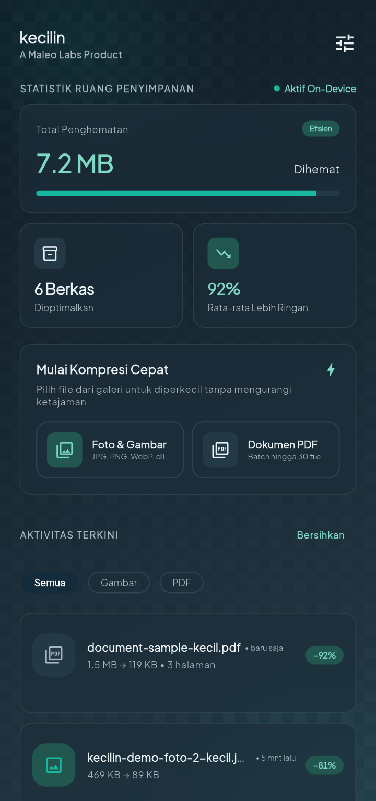
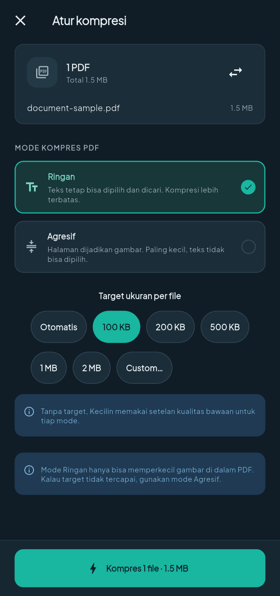
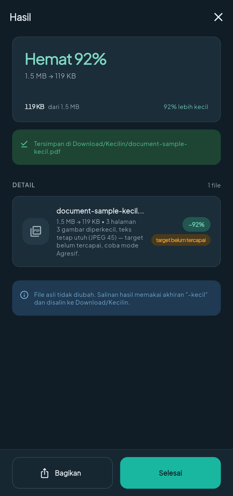

<div align="center">

<picture>
  <source media="(prefers-color-scheme: dark)" srcset="docs/assets/brand/kecilin-logo-dark.png">
  
</picture>

# Kecilin

**Less Size. More Value.**

An Android image and PDF compressor that runs **entirely on the device**.<br>
No server, no uploads, no account.


</div>

---

## Why this exists

The documents people compress most often are identity cards, family records,
diplomas and job applications — all of them personal. Uploading them to someone
else's server just to make a file smaller is a bad trade.

Kecilin does not make that trade. A file is read, compressed and written back on
the same phone. The release build **has no `INTERNET` permission**, so there is
no path for a document to leave the device even if a bug appears later.

---

## Features

| | |
| --- | --- |
| **Image formats** | JPG, JPEG, PNG, WebP, HEIC/HEIF, BMP → JPG or WebP |
| **Image modes** | Byte-size target, quality presets, near-lossless, resolution cap |
| **PDF Light** | Text layer preserved; only the images inside are re-encoded |
| **PDF Aggressive** | Each page is rasterised and rebuilt into a new PDF |
| **Size targets** | Presets 100 KB / 200 KB / 500 KB / 1 MB / 2 MB, or a free-form value (`250 KB`, `1.5 MB`) |
| **Batch** | Up to 30 files in one queue, per-page progress, cancellable |
| **Gallery** | Recent-photo grid with multi-select, plus the system file picker |
| **Output** | Saved to `Download/Kecilin` through MediaStore, no storage permission |
| **Extras** | History with total savings, share, open-with, light/dark theme |

### Guarantees the code actually enforces

1. **The original file is never modified or deleted.** Output is always a new file suffixed `-kecil`.
2. **Output is never larger than the source.** If re-encoding would grow the file, the original bytes are returned instead.
3. **A file already below the target is left alone**, provided the format is acceptable and no resize was requested.
4. **The extension never lies.** When original bytes are kept, the original extension is kept with them.
5. **Cancelling mid-run leaves no partial file behind.**
6. **One failing file does not abort the queue.**

---

## Screenshots

<!-- Captured on a physical Android 16 device; status and navigation bars cropped. -->

| Home | Compression setup | Result |
| --- | --- | --- |
|  |  |  |

---

## Platform support

| Platform | Status |
| --- | --- |
| Android 7.0 (API 24) – Android 16 (API 36) | **Supported.** The release build was verified on a physical device running Android 16 (arm64-v8a); other API levels have not been device-tested |
| iOS | **Not implemented.** There is no `ios/` folder; scaffolding and verification require macOS + Xcode |

Supported ABIs: `arm64-v8a`, `armeabi-v7a`, `x86_64` (emulator).

---

## Stack

| Layer | Technology |
| --- | --- |
| UI | Flutter 3.38 / Dart 3.10, Material 3, project-owned design tokens |
| State | `ChangeNotifier` + one `InheritedWidget` — no state-management framework |
| Image engine | Kotlin: `BitmapFactory` (single decode), `Bitmap.compress`, binary search over quality |
| PDF Light | Kotlin + PDFBox-Android: rewrite JPEG streams in place |
| PDF Aggressive | Kotlin: `PdfRenderer` + a purpose-built streaming PDF writer |
| Storage | `SharedPreferences` (history, settings), MediaStore (output) |
| Build | Gradle 8.14, AGP 8.11.1, Kotlin 2.2.20, R8 + resource shrinking |

Why Kotlin for the engines: Dart has no direct access to the hardware-accelerated
image codecs, `PdfRenderer`, or `MediaStore`. The reasoning behind each boundary
is documented in [`docs/architecture.md`](docs/architecture.md).

---

## Install

### As a user

Grab the `arm64-v8a` APK from the releases page and install it. Android will ask
you to allow installation from an unknown source, because the app is not
distributed through Google Play.

```bash
adb install -r kecilin-1.0.0-arm64-v8a.apk
```

> **Never install a debug APK.** Debug builds carry the `INTERNET` permission
> because Flutter needs it for hot reload. Only `release` builds are guaranteed
> to have no network access.

### As a developer

```bash
git clone git@github.com:maleolabs/kecilin.git
cd kecilin
flutter pub get
flutter run
```

Full prerequisites, test workflow and signing setup:
[`docs/development.md`](docs/development.md).

---

## Development

```bash
flutter pub get
dart format .
flutter analyze          # must report 0 issues
flutter test             # 22 unit + widget tests
```

Release build:

```bash
flutter build apk --release --split-per-abi
flutter build appbundle --release
```

A release build **requires** `android/key.properties`. Without it Gradle fails on
purpose, so a release APK can never be silently signed with a debug key. Copy
`android/key.properties.example` and fill it in.

### On-device tests

The integration suite exercises the real Kotlin engines (Android decoder, PDFBox,
`PdfRenderer`, MediaStore). Fixtures are synthetic and never shipped:

```bash
./tool/test_fixtures.sh                       # ~5 MB, gitignored
# add "- integration_test/assets/" to the existing assets: list in pubspec.yaml
flutter test integration_test/compression_test.dart -d DEVICE_ID
# remove that line again, then: rm -rf integration_test/assets
```

`flutter drive` refuses `--release`, so on-device suites run in `debug` or
`profile`. Minified-release behaviour is verified separately by installing the
release APK and exercising the UI by hand.

### CI

GitHub Actions runs formatting, `flutter analyze`, `flutter test`, and a release
Android build using a throwaway keystore — `ci.yml` never touches production keys.
Signed, distributable APKs come only from the tag-triggered
[`release.yml`](.github/workflows/release.yml), which holds the release key in a
protected environment behind an approval gate. See
[`docs/releasing.md`](docs/releasing.md).

---

## Privacy and security

Short version: **no data is sent anywhere.**

| | |
| --- | --- |
| `INTERNET` permission in release builds | Absent |
| Network dependencies | None |
| Analytics / crash reporting | None |
| Accounts / login | None |
| EXIF metadata (including GPS) | Stripped whenever an image is re-encoded |
| Cloud backup and device transfer | Disabled at manifest level |
| Temporary file location | App `cacheDir`, cleared on next launch |

The only thing that leaves the device is a file **you** send with the Share
button, to an app **you** choose.

Full detail, including the threat model and how to verify these claims yourself:
[`docs/security/privacy-architecture.md`](docs/security/privacy-architecture.md).

Found a security issue? Please do not open a public issue — see
[`SECURITY.md`](SECURITY.md).

---

## Repository layout

```
lib/                  Dart application (core, domain, data, state, ui, feature)
android/              Android host + Kotlin engines
assets/               font (with its OFL licence) and logo
test/                 unit and widget tests
integration_test/     on-device tests (fixtures generated locally)
test_driver/          driver for running the suite through flutter drive
tool/                 fixture and brand-asset generators
docs/                 architecture, development, security, performance
```

---

## Documentation

| Document | Contents |
| --- | --- |
| [Architecture](docs/architecture.md) | Layers, channel contract, data flow, invariants |
| [Development](docs/development.md) | Setup, tests, build, signing, troubleshooting |
| [Privacy architecture](docs/security/privacy-architecture.md) | What data is touched, where it goes, for how long |
| [Performance report](docs/performance/performance-report.md) | Before/after sizes and bottlenecks |
| [Releasing](docs/releasing.md) | Versioning, signing, and release checklist |

---

## Contributing

Contributions are welcome. Read [`CONTRIBUTING.md`](CONTRIBUTING.md) first —
it covers the coding standard, the test gate, and what a good pull request looks
like. Security-sensitive changes get an extra review pass.

---

## License

MIT — see [`LICENSE`](LICENSE).

**Plus Jakarta Sans** is used under the SIL Open Font License 1.1; the licence
text ships with the font in
[`assets/fonts/OFL-PlusJakartaSans.txt`](assets/fonts/OFL-PlusJakartaSans.txt).

---

## Credits

Built by **Maleo Labs**.

- [Flutter](https://flutter.dev) — framework
- [PDFBox-Android](https://github.com/TomRoush/PdfBox-Android) — PDF object model
- [Plus Jakarta Sans](https://github.com/tokotype/PlusJakartaSans) — typography
- Material Icons — UI

*Less Size. More Value.*
